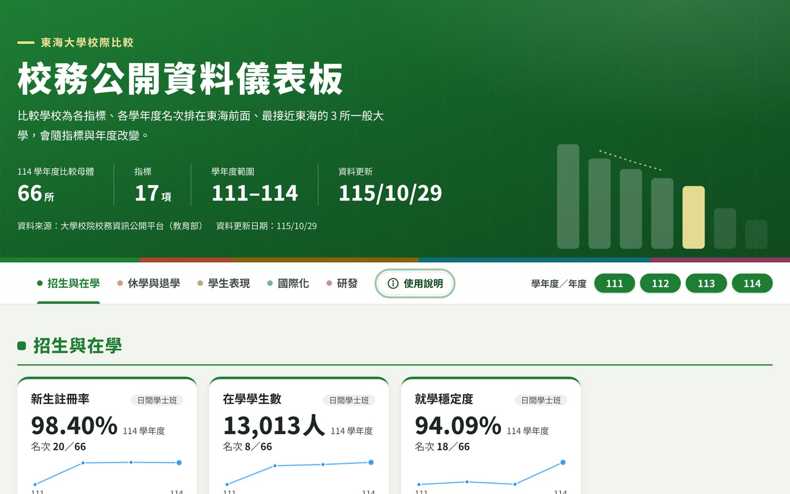

# 校務公開資料儀表板：校際比較

以教育部「大學校院校務資訊公開平台」的公開統計，呈現東海大學在全國一般大學中的名次，並列出名次排在東海前面、數值最接近的 3 所學校。

**[開啟儀表板](https://chen-pj.github.io/thu-ir-cross-school/)**

## 內容

共 17 項指標，分為 5 組，可選 111～114 學年度，並可切換學制。

| 分組 | 指標 |
| --- | --- |
| 招生與在學 | 新生註冊率、在學學生數、就學穩定度 |
| 休學與退學 | 休學人數、退學人數 |
| 學生表現 | 實習人次、參與競賽獲獎人次、論文出版及展演人次、競賽與論文出版合計 |
| 國際化 | 僑生及港澳生、本國學生出國進修交流、大陸地區來臺學位生、雙聯學制學生、外國學生 |
| 研發 | 學術研究計畫經費、產學合作計畫經費、智慧財產權衍生運用金額 |

點任一指標卡片，可看各年度名次、折線圖，以及當年最接近東海的 3 所學校與差距。

## 比較方式

- **比較對象**：每學年度學校類別為「一般大學」的公私立學校（不含技專校院、宗教研修學院），114 學年度共 66 所。
- **排名**：每項指標、每個學制、每個年度各自排名。數值越高越前面；休學、退學人數則是越少越前面。同分給相同名次。
- **比較學校**：名次在東海前面、數值最接近的 3 所，會隨指標、學制、年度改變。

## 資料來源與年度

- 來源：[大學校院校務資訊公開平台](https://udb.moe.edu.tw/udata/ReportCategories)（教育部）
- 範圍：111～114 學年度；研發類指標以「年度」計，至 113 年度
- 部分指標平台只公布到 113 學年度，各卡片都會標示「資料至」哪一年
- 本次資料更新：115 年 10 月 29 日

## 解讀時請注意

- 名次與差距只描述數字所在的位置，不代表表現優劣，也不代表因果。
- 人次類指標同一人可能重複計算。
- 結果為全校層級，不能推論到個別學系。

## 製作與維護

東海大學永續發展暨校務研究處 校務研究組。每年教育部公布新資料後更新一次，更新步驟見 [維護說明](docs/維護說明.md)。
